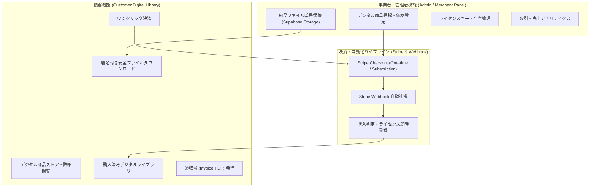

# 東栄ポータル デジタル商品取引プラットフォーム拡張提案書

東栄ポータル（非住民ポータル側・事業者/顧客取引ポータル）において、顧客とのデジタル商品（電子コンテンツ、ソフトウェアライセンス、デジタルデータ、電子書類、APIアクセス権等）の取引・決済・納品を安全かつシームレスに運用するための新機能拡張計画をご提案します。

---

> [!IMPORTANT]
> **本提案の目的**
> 既存の Stripe 決済基盤および Supabase アーキテクチャを拡張し、デジタル商品の「展示・カタログ」「ワンタイム/サブスク決済」「安全な即時ファイル納品」「ライセンス・シリアルキー発行」「事業者向け取引管理」を完備した統合デジタルコマース機能を導入します。

---

## 💡 システム全体の機能構成案



---

## 📦 主な追加機能一覧

### 1. 顧客向け デジタル商品ストア＆購入ライブラリ (`/store` / `/dashboard/library`)
1. **デジタル商品カタログ・詳細ページ (`/store`, `/store/[id]`)**
   - 電子書籍・PDF資料、ソフトウェア・スクリプト、ライセンスキー、データ素材などの商品カタログ。
   - 販売形態（単品買い切り価格 / 月額サブスクリプション）の明確な表示。
2. **ワンクリック Stripe 決済 (`/api/store/checkout`)**
   - Stripe Checkout を利用した安全な決済処理。
   - クレジットカード決済完了後、即座に購入者専用ライブラリへリダイレクト。
3. **購入済みデジタルライブラリ (`/dashboard/library`)**
   - 顧客が購入したすべてのデジタルコンテンツの一覧・所有証明表示。
   - **安全なファイルダウンロード**: 直リンクによる不正拡散を防止するため、Supabase Storage の「有効期限付き署名 URL (Signed URL)」を動的生成して安全にダウンロード。
   - **ライセンスキー・アクティベーションコード照会**: ソフトウェアやサービス用のシリアルコード・APIキーの即時表示・コピー機能。
   - **領収書 PDF のダウンロード**: Stripe Invoice 連携による公式領収書の発行。

---

### 2. 事業者・管理者向け デジタルコマース管理パネル (`/admin/store`)
1. **デジタル商品登録・編集 (`/admin/store/products`)**
   - 商品名、詳細説明、価格、販売種別（単品/定期）、カバー画像、タグの設定。
   - Stripe Price ID の自動紐付け・生成。
2. **納品用コンテンツファイル管理 (`/admin/store/files`)**
   - 非公開の Supabase Storage バケット (`digital-product-contents`) への納品用 ZIP/PDF/データファイルのセキュアアップロード。
   - バージョン管理（例: `v1.0.0`, `v1.1.0` の差し替え）。
3. **ライセンスキー・シリアルコードプール (`/admin/store/licenses`)**
   - ソフトウェアライセンスや電子コードの一括インポート・自動割り当て管理。
4. **取引・注文管理ダッシュボード (`/admin/store/orders`)**
   - 取引日時、購入者メールアドレス、決済金額、ステータス（`completed`, `refunded`）、返金処理連携。

---

## 🗄️ データベース設計案 (Supabase SQL)

新規に以下の4テーブルおよび RLS (Row Level Security) ポリシーを追加します。

### 1. `digital_products` (デジタル商品マスタ)
```sql
create table if not exists public.digital_products (
  id uuid primary key default gen_random_uuid(),
  title text not null,
  slug text unique not null,
  description text not null default '',
  price_amount integer not null default 0, -- 円単位価格
  currency text not null default 'jpy',
  billing_type text not null default 'one_time', -- 'one_time' or 'subscription'
  stripe_price_id text,
  file_path text, -- Supabase Storage 内の非公開パス
  is_published boolean not null default false,
  created_at timestamptz not null default now(),
  updated_at timestamptz not null default now()
);
```

### 2. `digital_orders` (デジタル商品 取引・注文履歴)
```sql
create table if not exists public.digital_orders (
  id uuid primary key default gen_random_uuid(),
  order_number text unique not null, -- 例: 'ORD-20261109-001'
  user_id uuid references public.profiles(id) on delete cascade,
  product_id uuid references public.digital_products(id) on delete restrict,
  stripe_session_id text unique,
  stripe_payment_intent text,
  amount_paid integer not null default 0,
  status text not null default 'completed', -- 'completed', 'refunded'
  created_at timestamptz not null default now()
);
```

### 3. `digital_licenses` (ライセンスキー・発行コード管理)
```sql
create table if not exists public.digital_licenses (
  id uuid primary key default gen_random_uuid(),
  product_id uuid references public.digital_products(id) on delete cascade,
  order_id uuid references public.digital_orders(id) on delete set null,
  user_id uuid references public.profiles(id) on delete set null,
  license_key text not null, -- シリアルコード / ライセンスキー
  status text not null default 'available', -- 'available', 'assigned', 'revoked'
  assigned_at timestamptz,
  created_at timestamptz not null default now()
);
```

---

## 🛡️ セキュリティと納品保護の仕組み

> [!NOTE]
> **直リンク・無断拡散防止ロジック**
> - 納品ファイルはパブリックバケットではなく、完全非公開バケット `digital-product-contents` に暗号化保管されます。
> - 顧客が「ダウンロード」を押した際、サーバー API (`/api/store/download`) が RLS および `digital_orders` の購入履歴を検証し、**購入者本人のみに有効期限60秒の署名付きURL** を動的発行します。

---

## 🗺️ 実装ステップ案

| ステップ | 内容 | 成果物 |
| :--- | :--- | :--- |
| **Phase 1** | DBマイグレーション作成 & Supabase Storage 設定 | `supabase/migrations/20261109000000_digital_products.sql` |
| **Phase 2** | 商品ストア & 詳細画面の実装 | `src/app/store/page.tsx`, `src/app/store/[slug]/page.tsx` |
| **Phase 3** | Stripe Checkout & Webhook 自動納品処理 | `src/app/api/store/checkout/route.ts`, `webhook/route.ts` |
| **Phase 4** | 顧客向けデジタルライブラリ画面 | `src/app/dashboard/library/page.tsx` |
| **Phase 5** | 管理者向けデジタル取引管理パネル | `src/app/admin/store/page.tsx` |

---

ご検討のほどよろしくお願いいたします。ご承認をいただけましたら、上記設計に基づきデータベースの作成およびストア機能の実装を進めてまいります。
